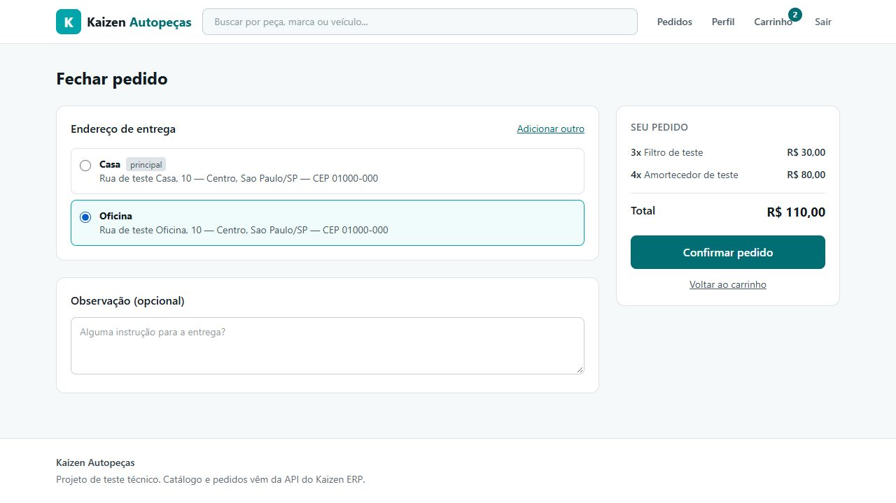
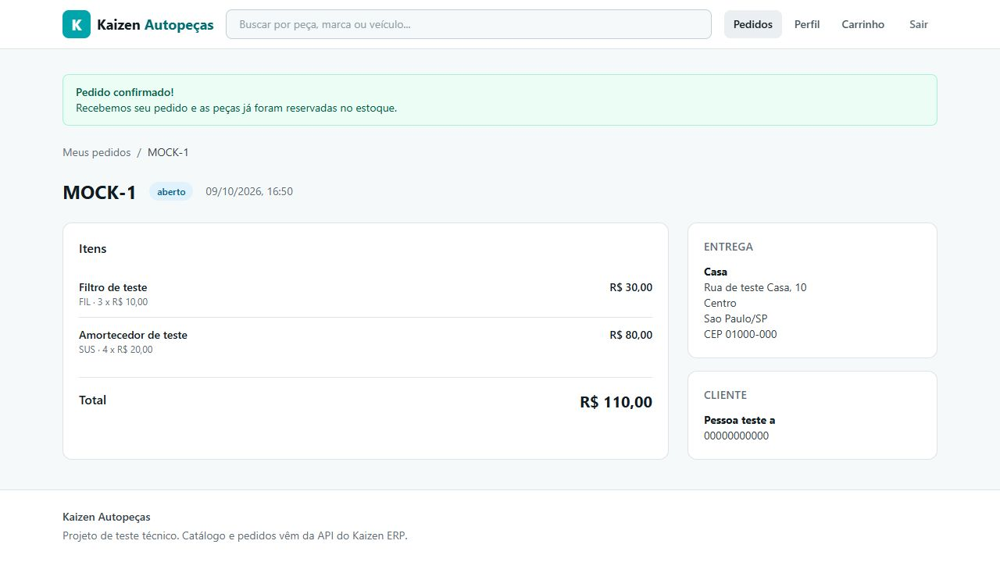
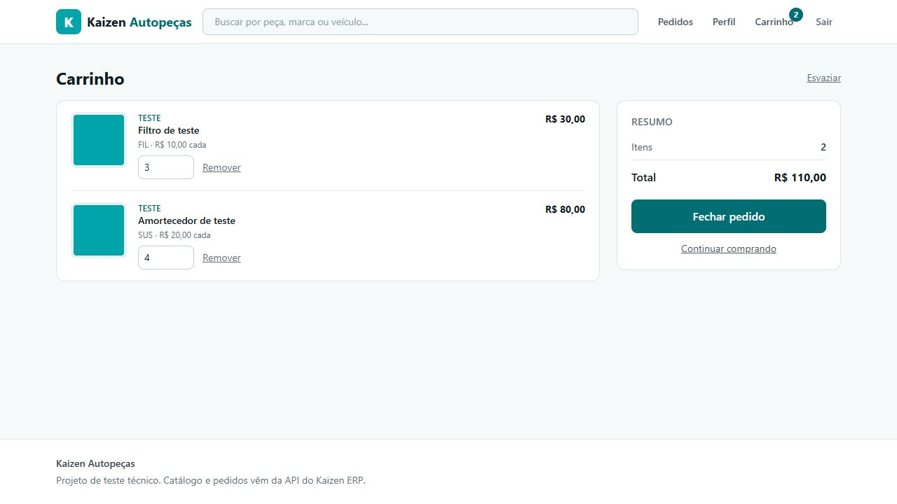

# Dia 1 — evidências e ponto de retomada

Data: 09/10/2026 (Brasília). Escopo: preparação, execução e investigação.
**Nenhum dos quatro chamados foi corrigido. Múltiplos carrinhos não foi iniciado.**

## Base e segurança da importação

- Workspace recebido: `main`, limpo, origem `PecistaTecnologia/teste-tecnico-kaizen`, HEAD `81897d5` e seis commits da empresa.
- Entrega já existia: `master`, raiz `69c48436698c63cc2bbfc5cdd3a3a3c7131e3f9e`, com README de duas linhas, licença MIT e `.gitignore`.
- O histórico da entrega foi conservado. A importação parte dele, sem mesclar os ancestrais da empresa e sem force-push.
- README da entrega preservado em `docs/README-repositorio-entrega-original.md`; licença e regras anteriores do `.gitignore` mantidas.
- A cópia de recuperação do Git original está **fora** do workspace, em `C:\DEV\kaizen-dia1-backup-20261009\original.git`. Contém a base original, inclusive suas credenciais históricas: não publicar esse backup.
- O movimento inicial de `.git` encontrou atributo oculto no Windows e moveu parcialmente o conteúdo. O HEAD do backup foi verificado antes de copiar os metadados da entrega para o diretório vazio. Nenhum arquivo de aplicação foi descartado.
- Credenciais fixas encontradas em `backend/src/config.js` foram removidas antes do primeiro commit de importação. O segredo JWT local foi gerado aleatoriamente; SIAC_TOKEN fica apenas no ambiente local/`.env` ignorado. Não há valor de credencial neste relatório.
- Acrescentados aliases `SIAC_URL`/`SIAC_TOKEN`, com precedência sobre `ERP_URL`/`ERP_TOKEN`; aliases anteriores continuam funcionando. Ausência de segredo/token impede a inicialização. URL pública pode ter padrão; credenciais não.
- `.gitignore` exclui `.env`, SQLite e seus journals, dependências, `dist` e `.local`. Lockfiles permanecem versionados.
- O banco original `backend/data/ecommerce.db` foi preservado localmente e excluído da importação. Estava vazio nas quatro tabelas de negócio. O desenvolvimento usa outro arquivo, `backend/data/desenvolvimento.db`.

## Ambiente e comandos executados

Node do sistema: 26.5.0. Para o desafio foi instalado **Node 24.21.0 LTS**, npm 11.19.0, em diretório local do usuário, sem trocar o Node global.
O [calendário oficial](https://github.com/nodejs/Release) coloca Node 24 em Active LTS em 09/10/2026; Node 26 só entra em LTS em 28/10.
O ZIP Windows x64 foi obtido de `nodejs.org/dist`, com SHA-256 conferido contra `SHASUMS256.txt`. `.nvmrc` registra a versão utilizada.

PowerShell, antes dos comandos desta máquina:

```powershell
$env:PATH = "$env:LOCALAPPDATA\kaizen-tools\node-v24.21.0-win-x64;$env:PATH"
node --version
npm --version
```

Comandos executados no backend:

```powershell
Set-Location C:\DEV\teste-tecnico-kaizen\backend
npm ci
npm run db:init
npm start
```

Em outro terminal, frontend:

```powershell
Set-Location C:\DEV\teste-tecnico-kaizen\frontend
npm ci
npm run dev -- --host 127.0.0.1
```

Validação e investigação:

```powershell
# Em frontend
npm run build
# Em backend: banco descartável e bloqueio de rede fora de loopback
node scripts/diagnostico-dia1.mjs
# Opcional, para repetir manualmente as evidências de UI isolada
node scripts/diagnostico-dia1.mjs --servir
```

O modo `--servir` usa portas 3002/5174 e SIAC simulado; conta fictícia `a@example.test` tem Casa principal, Oficina secundária e 3 filtros + 4 amortecedores; `b@example.test` tem carrinho vazio. A senha **fictícia** de ambas é `TesteLocal123`. Não é uma credencial de sistema externo. Encerrar com Ctrl+C após usar. O banco de UI é temporário, separado do banco de desenvolvimento.

Configuração local criada: `HOST=127.0.0.1`, `PORT=3001`, `NODE_ENV=development`, `DB_PATH=./data/desenvolvimento.db`, `SIAC_URL=https://teste-tecnico.kaizenautopecas.com.br`, JWT aleatório e token fornecido localmente. Em uma nova máquina, copiar `backend/.env.example` para `backend/.env` e preencher segredos **fora do Git**. Executar comandos a partir do backend: `dotenv/config` resolve `.env` pelo diretório atual.

Resultados observados:

| Verificação | Resultado em 09/10 |
|---|---|
| `npm ci` backend | 120 pacotes; auditoria automática: 0 vulnerabilidades reportadas |
| `npm ci` frontend | 82 pacotes; auditoria automática: 0 vulnerabilidades reportadas |
| Dependências nativas | better-sqlite3 carregou e criou banco; esbuild executou o build |
| Avisos de instalação | prebuild-install descontinuado; npm alertou sobre scripts de better-sqlite3/esbuild ainda não cobertos por allowScripts; não impediram a execução observada |
| `db:init` | Quatro tabelas vazias no novo banco; sem usar `db:reset` |
| SQLite original e desenvolvimento | `integrity_check=ok`, `foreign_key_check=[]`, `user_version=0` |
| SIAC `/health` | HTTP 200, `status=ok` |
| BFF `/api/health` | HTTP 200, `status=ok`, `erp=ok`; consulta SQLite executada |
| Vite `/` e `/api/health` | HTTP 200; HTML e proxy funcionando |
| SIAC via `/api/catalogo?tamanho=2` | HTTP 200; total de 55 produtos, dois na página; token aceito |
| `/api/catalogo/categorias` | Nove categorias retornadas |
| Busca `amortecedor`, página 1 | Três produtos |
| Mesma busca, página 2 | Zero produtos, mas `total=3` e `total_paginas=1` |
| Frontend build | Vite 7.3.7, 58 módulos, sucesso |
| Diagnóstico isolado | 20 grupos de evidências concluídos, exit code 0 |
| Testes/lint originais | Não há scripts de teste ou lint nos manifests |

`npm run dev` no backend usa `node --watch`; `npm start` inicia sem watcher. Backend não tem etapa de compilação. Frontend dispõe de `dev`, `build` e `preview`. `preview` não substitui a implantação da API; o caminho previsto para produção é build do frontend servido pelo Express com `NODE_ENV=production`. Publicação, HTTPS e cookie seguro em produção continuam pendentes. `db:reset` apaga dados e **não foi executado**.

## Mapa técnico verificado

### Backend

`server.js` valida configuração, aplica schema, abre Express e encerra conexões em SIGTERM/SIGINT. `app.js` monta JSON até 128 KB, CORS, cookies, request-id, logs, rotas e tratamento final de erros. Em produção serve `frontend/dist` com fallback da SPA.

| Módulo | Caminhos sob `/api` | Fluxo |
|---|---|---|
| `routes/auth.js` | POST cadastro/login/logout; GET auth/eu | Valida payload, chama usuarioService, assina JWT/cookie; eu exige sessão |
| `routes/perfil.js` | GET/PATCH perfil; PATCH perfil/senha | Dados pessoais e senha do usuário autenticado |
| `routes/enderecos.js` | GET/POST enderecos; PUT/DELETE enderecos/:id | Validação completa, serviço com filtro por usuário e transações |
| `routes/catalogo.js` | GET catalogo, categorias, :codigo | Paginação normalizada, força ativo=true, ERP e reescrita da imagem |
| `routes/imagens.js` | GET imagens/:arquivo | Nome simples `.svg`, stream do ERP, cache de sete dias |
| `routes/carrinho.js` | GET/DELETE carrinho; POST itens; PATCH/DELETE itens/:codigo | Sessão, quantidade de 1 a 99; carrinhoService |
| `routes/pedidos.js` | POST/GET pedidos; GET pedidos/:numero | Checkout e histórico; posse checada antes de buscar detalhe no ERP |
| `app.js` | GET health | SELECT 1 e consulta ERP; `status` local continua ok mesmo se ERP falhar |

Services: `usuarioService` cria conta, hash scrypt, login, perfil e senha; `enderecoService` cria/edita/remove e escolhe principal; `carrinhoService` guarda códigos/quantidades e enriquece por HTTP; `pedidoService` lê carrinho, valida disponibilidade/posse, cria pedido remoto, grava vínculo/snapshot e limpa carrinho em transação local.

`middleware/autenticacao.js`: JWT `sub=usuario.id`, cookie httpOnly/SameSite=Lax, secure em produção, expiração padrão 7 dias; consulta usuário em cada acesso. Logout só limpa cookie. `lib/senha.js`: scrypt N=16384/r=8/p=1, salt aleatório, comparação timingSafeEqual. Login desconhecido também calcula hash. Cadastro usa UNIQUE no email e trata a corrida de inserção.

`lib/validacao.js`: ColetorDeErros acumula falhas, tipos/textos/tamanhos, CPF/CNPJ por comprimento, CEP/UF, booleanos e paginação. SQL parametrizado em rotas de negócio. `lib/ApiError.js` e `middleware/erros.js`: envelope `erro.{codigo,mensagem,detalhes?}` + request_id; JSON inválido 400, corpo grande 413, inesperado 500, detalhes suprimidos em produção.

`erp/cliente.js` concentra fetch, `X-API-Token`, timeout, encode de identificadores, repasse de 404/409/422 e conversão de 401/5xx/rede em 502. Não há retries automáticos de pedidos. Imagens e health têm caminhos próprios. Falhas ao enriquecer carrinho são capturadas e convertidas em item indisponível, inclusive falhas transitórias; lista de pedidos degrada status para INDISPONIVEL.

### Frontend

`main.jsx`: StrictMode → BrowserRouter → ProvedorAuth → ProvedorCarrinho → App. `App.jsx`: `/`, `/produto/:codigo`, `/entrar`, `/cadastro`; rotas protegidas `/carrinho`, `/checkout`, `/pedidos`, `/pedidos/:numero`, `/perfil`; fallback não encontrado. RotaProtegida é proteção de navegação; segurança é do backend.

- `AuthContext`: consulta `/auth/eu` no boot, mantém usuário e ações de sessão.
- `CarrinhoContext`: consulta no mount; alterações substituem o objeto retornado pelo servidor. Não acompanha mudanças de usuário nem ordena respostas concorrentes.
- `api/cliente.js`: fetch relativo `/api`, credentials=include, ErroApi e erros por campo; nenhum token SIAC no frontend.
- `Cabecalho`: formulário de busca e badge; pesquisa preserva query atual. Campo de busca só inicializa a partir da URL.
- `Catalogo`: useSearchParams para busca/categoria/página/disponíveis, efeito protege contra respostas de consultas antigas; busca 24 itens. CardProduto adiciona; Paginacao é compartilhada com Pedidos.
- `Carrinho`: altera quantidade/remove/limpa pelo contexto; resumo usa campos calculados no backend. Inputs ficam bloqueados para indisponíveis.
- `Checkout`: carrega endereços, inicializa principal/primeiro, radio atualiza enderecoId, formulário pode cadastrar novo; finalizar monta payload, cria pedido e navega para detalhe.
- `Perfil`: dados, senha e CRUD de endereços; `Pedidos`/`PedidoDetalhe`: status e snapshot; `ui.jsx`: botões, validação, alertas, estados vazios, paginação.

### Banco

| Tabela | Relação/regras |
|---|---|
| usuarios | id PK, email UNIQUE, senha_hash, documento/telefone e timestamps |
| enderecos | usuario_id FK CASCADE; principal CHECK 0/1; endereço e timestamps |
| carrinho_itens | usuario_id FK CASCADE; UNIQUE(usuario_id,codigo_produto); quantidade CHECK >0; sem preço persistido |
| pedidos_usuario | usuario_id FK CASCADE; numero_erp UNIQUE; snapshot endereço JSON; total em centavos; criado_em |

Índices por usuário e email; WAL, foreign_keys=ON e busy_timeout=5000. Não há tabela carrinhos: um carrinho implícito por usuário. Produtos/estoque/pedidos detalhados ficam no ERP. Não há migrações versionadas, apenas DDL `CREATE ... IF NOT EXISTS`; executar novamente não altera colunas de bancos existentes. `user_version=0` confirma ausência de versão aplicada nos bancos examinados. Múltiplos carrinhos exigirá migração explícita e preservação dos itens atuais.

## Quatro chamados: causas, reprodução e correções recomendadas

### KZN-312 — total com itens indisponíveis

**Confirmado por execução do serviço real com mock HTTP e SQLite temporário.** Em `carrinhoService.enriquecerItens`, subtotal é calculado antes de avaliar ativo/estoque e continua positivo mesmo com `disponivel=false`. `lerCarrinho` soma todos os subtotais sem filtrar disponibilidade. `Carrinho.jsx` e `Checkout.jsx` exibem `valor_total` retornado, sem recálculo próprio.

Reprodução determinística: RAD 1 × 684 sem estoque + FIL 3 × 10 + SUS 4 × 20. Resultado 794, disponíveis somam 110, diferença 684. Checkout permanece bloqueado corretamente. O SIAC real também retornou ARR-7002 a 684 sem estoque durante a inspeção; não foi preciso alterar estoque remoto.

Precisão sobre o relato: **o total atual coincide com a soma de todas as linhas renderizadas**, incluindo a linha indisponível. A divergência confirmada é entre total e soma dos itens elegíveis. Não atribuir ao ERP uma soma aritmética incorreta.

Recomendação: manter item e motivo visíveis, definir explicitamente subtotal/total elegível e excluir indisponíveis do total comprável no serviço; preservar bloqueio de checkout com qualquer pendência. Documentar a escolha para estoque parcial: inicialmente tratar a linha toda como pendente até ajuste, sem reduzir quantidade silenciosamente.

Testes de sábado: disponível, estoque zero, inativo, quantidade maior que estoque, produto 404, erro 502/timeout, carrinho vazio, preços fracionários; invariantes de total e bloqueio. Efeitos colaterais: consistência entre subtotal visual/total, interação com bug monetário, não permitir checkout descartando itens silenciosamente.

### KZN-318 — unidades versus linhas

**Confirmado por serviço e navegador.** `carrinhoService.lerCarrinho` retorna tanto quantidade_itens quanto quantidade_pecas como `itens.length`. CarrinhoContext apenas armazena; Cabecalho e resumo leem quantidade_pecas.

Reprodução: FIL=3 e SUS=4 → quantidade_itens=2, quantidade_pecas=2, soma real=7. Após F5 na UI isolada, badge e resumo mostram 2.

Recomendação: quantidade_itens mantém linhas distintas; quantidade_pecas soma quantidades, inclusive de itens ainda presentes com pendência (contagem física escolhida; elegibilidade fica separada). Corrigir origem no backend, sem remendo no badge.

Testes: 3+4=7, mesma peça adicionada duas vezes, alterar/remover/limpar, vazio, pendentes, badge 99+, contrato API/contexto. Riscos: não trocar semântica de quantidade_itens usada por outras telas; tratar ciclo de sessão do contexto separadamente.

### KZN-325 — busca e filtros carregam página anterior

**Confirmado no navegador com SIAC real e por HTTP.** `Cabecalho.pesquisar` copia window.location.search e altera só busca. `Catalogo.trocarParametro` altera categoria/disponíveis/limpar busca sem remover pagina. A rota backend repassa essa pagina ao SIAC.

Reprodução: abrir catálogo, Próxima (página 2), digitar amortecedor, Enter → `/?pagina=2&busca=amortecedor`, mensagem Nenhuma peça encontrada. GET nessa página: dados=[], total=3, total_paginas=1; página 1: três produtos.

Recomendação: mudar critérios deve reiniciar página em 1/remover parametro pagina, preservando demais filtros; mudança exclusiva de página preserva critérios. Sincronizar texto da busca com URL em limpar/voltar/avançar. Avaliar normalização de página inválida acessada por link direto.

Testes: busca/limpeza/categoria/disponíveis após paginar, manutenção dos demais filtros, F5, histórico, link direto e resposta atrasada. Efeitos colaterais: evitar loop de efeito/useSearchParams e sobrescrever texto durante digitação. Há também off-by-one confirmado em Paginacao, descrito abaixo; não confundir suas duas causas.

### KZN-331 — seleção visual não enviada

**Confirmado de ponta a ponta com ERP mock.** `Checkout.finalizar` ignora enderecoId, recalcula `enderecos.find(principal) ?? enderecos[0]` e envia entrega.id. O radio e `enderecoSalvo` atualizam corretamente enderecoId, que só serve para seleção visual/habilitação.

Reprodução UI isolada: entrar como A, F5 para carregar carrinho, Fechar pedido, selecionar Oficina (id 2), Confirmar. Pedido MOCK-1 mostra Casa; mock registra `Entrega: Rua de teste Casa...`. Imagens em `docs/evidencias/kzn331-oficina-selecionada.png` e `kzn331-pedido-casa.png`.

Contraprova: chamada direta de `finalizarPedido(a, oficina.id, ...)` guarda Oficina no snapshot SQLite e envia Oficina na observação do mock. `routes/pedidos.js` lê o id corretamente; `buscarEndereco` filtra id e usuario_id. **Não é troca de endereço feita pelo ERP/backend.**

Recomendação: enviar enderecoId selecionado; principal é apenas valor inicial. Validar seleção ainda existente e apresentar erros da API. Preservar checagem de posse e snapshot no backend.

Testes: principal, secundário, endereço criado no checkout, nenhum endereço, removido em outra aba e endereço alheio; inspeção de payload, snapshot e observação; editar endereço depois não altera pedido anterior. Riscos: preservar limites de observação e estado durante envio. Pedidos reais não são necessários para regressão.

## Auditoria adicional

Prioridades: P0 antes de publicar; P1 segurança/integridade ou fluxo essencial; P2 comportamento incorreto secundário; P3 robustez/escala. Apenas a higienização de configuração/importação foi corrigida hoje.

| ID / prioridade | Comportamento e localização | Evidência / impacto | Recomendação |
|---|---|---|---|
| A01 P0 | Credenciais ERP e segredo JWT fixos em config.js original (marcador KZN-2B9C) | Confirmado por leitura; segredo conhecido permite assinar sessões se o padrão estiver em uso. Token real não deve ser republicado. Não foi tentada exploração contra sistema externo. | Valores removidos antes da importação; fail-fast confirmado. Revogação/rotação de credencial histórica depende do responsável pelo SIAC e não foi feita. |
| A02 P1 | `lib/dinheiro.js::paraCentavos` usa Math.floor | Executado: 1.15 → 114. Carrinho converte preço e depois subtotal novamente; pedido local também converte total ERP. Pode perder centavos em mais de uma etapa. | Corrigir conversão central, testar preços reais, multiplicação/soma e limites; não remendar formatação frontend. |
| A03 P1 | CarrinhoContext não depende de AuthContext; estado persiste no logout/login | UI: A tem 3 FIL+4 SUS; sair e entrar B sem recarregar mantém itens/total de A. Login inicial também mostra vazio até F5. API de B retorna vazio: vazamento visual de estado, não IDOR de banco comprovado. | Limpar/recuperar ao mudar usuário e invalidar respostas de sessão anterior; testar login/logout/troca/401. Screenshot carrinho-conta-b.png. |
| A04 P1 | `pedidoService.finalizarPedido` sem idempotência ou exclusão por carrinho | Duas chamadas aguardando ERP criaram dois pedidos e dois vínculos. Desabilitar botão só protege uma instância da tela. | Persistir tentativa/chave, proteger checkout por carrinho e definir retries; verificar suporte real do ERP a idempotência antes de prometer exactly-once. |
| A05 P1 | `limparCarrinho(usuario.id)` após aguardar ERP remove tudo | Teste com barreira: SUS adicionado durante pedido de FIL foi apagado e não constou no pedido. | Snapshot/versionamento do carrinho; impedir ou reconciliar mutações durante fechamento. Abranger abas/processos. |
| A06 P1 | Timeout depois de aceite remoto sem reconciliação | Mock aceitou pedido, atrasou resposta; loja retornou 502, sem vínculo, carrinho preservado. Retry pode duplicar. Falha local após aceite é limitação já documentada, não novidade. | Tentativa persistente/reconciliação e decisão explícita de retry. Documentar fronteira transacional; teste de falha de gravação local ainda pendente. |
| A07 P1 | `app.js` reflete qualquer Origin com credentials=true, ignora corsOrigem | HTTP autenticado com Origin arbitrária retorna ACAO dessa origem e ACAC=true. Exfiltração cross-site em navegador NÃO comprovada; SameSite=Lax restringe cookies, subdomínios same-site mudam o cenário. | Mesma origem/allowlist por ambiente; testar preflight e cookies. Não declarar bypass universal de sessão. |
| A08 P2 | `ui.jsx::Paginacao`: Próxima desabilita em pagina >= totalPaginas-1 | UI real: página 2 de 3, Próxima já desabilitada; com duas páginas desabilita na primeira. Afeta catálogo e pedidos. | Comparar com última página correta, testar 1/2/3 páginas e limites. Tratar junto à regressão de KZN-325. |
| A09 P2 | `Carrinho.jsx::LinhaItem` desabilita quantidade em !disponivel | Confirmado por leitura: estoque cai abaixo da quantidade, serviço marca indisponível e UI bloqueia justamente a redução. Não reproduzido visualmente com estoque variável. | Permitir ajustar pendência de estoque parcial; diferenciar ausente/inativo/zero. Criar fixture 4 unidades com estoque 2. |
| A10 P2 | `usuarioService.atualizarPerfil` usa telefone || atual.telefone | HTTP PATCH com telefone vazio retornou telefone antigo. | Preservar intenção de limpar via null; testar vazio/nulo/novo e semântica de campo ausente. |
| A11 P2 | `enderecoService.atualizarEndereco` permite desmarcar único principal | Reproduzido: zero principais com dois endereços. Fallback escolhe primeiro, mas contradiz intenção de sempre haver padrão. | Definir política de promoção/impedimento e testar edição/remoção; avaliar índice único parcial para no máximo um. |
| A12 P2 | Cadastro valida senha sem trim; login/troca usam textoObrigatorio para senha atual | Cadastro com espaços nas extremidades funciona; mesmo texto no login dá 401. Hash usa texto integral normalizado NFKC. | Consistência sem trim de senha; testar cadastro/login/troca com espaços, Unicode e normalização. |
| A13 P1 | JWT não revogado na troca de senha; logout só remove cookie | Replay HTTP do cookie antigo continua 200 após ambos. É característica do modelo stateless, não falha de assinatura. | Revogar sessões na troca de senha (versão de sessão/credencial); decidir política de logout; testar expiração e sessões antigas. |
| A14 P2 | inteiroPositivo converte tipos arbitrários com Number | PATCH quantidade=true e [2] aceitos como 1 e 2. | Aceitar somente tipos definidos no contrato; rejeitar booleano/array/objeto; testes 0/negativo/fracionário/limites. |
| A15 P2 | adicionarItem satura quantidade silenciosamente em 99 | 98 + 5 retornou 99 sem conflito. | Decisão explícita de limite e erro/aviso; validar que adicionar não informa sucesso integral quando só parte entrou. |
| A16 P2 | cliente ERP aceita HTTP 200 com JSON inválido como null | Mock nao-json → catálogo BFF 200 com lista vazia. Em criação/detalhe pode virar null/erro interno. | Validar formato de sucesso e transformar falha de contrato em 502; testar corpo inválido, ausente e dados incompletos. |
| A17 P2 | Cabecalho guarda busca apenas no useState inicial | UI: clicar limpar remove busca da URL, mas campo continua amortecedor. | Sincronização URL/estado no KZN-325; testar histórico e navegação para home. |
| A18 P2 | Header `min-w-[380px]`, catálogo `grid-cols-4` sem breakpoints | Suspeita fundamentada por CSS: risco de overflow e cards estreitos no celular. Não foi feita medição de viewport móvel. | Reproduzir em 360/390 px e corrigir responsividade ao planejar carrinho na vitrine; preservar paleta. |
| A19 P2 | Auth sem rate limit; trust proxy=true | Ausência confirmada por inspeção; não houve teste de carga/força bruta nem infraestrutura reversa disponível. | Limite por conta/IP, proxy confiável conforme implantação. Não assumir X-Forwarded-For seguro por padrão. |
| A20 P2 | CarrinhoContext aceita qualquer resposta e transforma todo erro de leitura em vazio | Suspeita de resposta antiga sobrescrever mutação nova; erro 502 pode parecer carrinho vazio. Não foi injetada corrida no navegador. | Versionar requisições/estado e separar 401 de falha de rede; teste controlado com respostas invertidas. |
| A21 P3 | PedidoDetalhe/Pedidos não limpam erro no início do novo efeito | Leitura: falha anterior permanece mesmo após próxima consulta bem-sucedida. Não reproduzido no navegador. | Limpar erro e testar navegação/recuperação após falha; documentar se fora do prazo. |
| A22 P3 | Log de acesso registra originalUrl; stream de imagem sem handler de erro explícito | Inspeção: query sensível iria para log; falha tardia do stream não foi simulada. Token SIAC atual é header e não entra nesse caminho. | Sanitizar logs e simular falha de stream; não afirmar vazamento ocorrido. |

Pontos conferidos que **não** foram classificados como bugs: queries de endereços/carrinhos/pedidos filtram usuário; pedido alheio é bloqueado antes da chamada ERP; sem senha_hash nas respostas; scrypt com salt; checkout revalida disponibilidade; conflito 409 remoto preserva carrinho; UNIQUE de cadastro tratado; express.json limita tamanho. CPF/CNPJ só por tamanho, sem pagamento/frete, sem recuperação de senha e N chamadas por página de pedidos são limites de escopo já declarados.

## Plano para sábado, 10/10

Não repetir investigação inicial: usar as fixtures, contraprovas e arquivos abaixo. Criar uma branch curta por chamado quando começar, integrar em main com commits coerentes. Não criar branches futuras antecipadamente.

| Ordem | Alterar | Testes novos de comportamento esperado | Riscos a validar |
|---|---|---|---|
| 1. KZN-312 | backend/src/services/carrinhoService.js; corrigir dinheiro.js em commit próprio relacionado; Carrinho.jsx/Checkout.jsx somente se contrato de subtotal exigir | node:test para centavos/totais/elegibilidade, ERP mock 404/502/estoque parcial/inativo; checagem visual dos subtotais | Total elegível claro, nenhuma compra silenciosa de subconjunto, revalidação ERP, perda de centavos |
| 2. KZN-318 | carrinhoService.js; preservar consumidores; tratar CarrinhoContext/AuthContext em commit separado para A03 | Contrato linhas=2/unidades=7; adicionar/alterar/remover/limpar; badge 99+; troca de sessão e respostas antigas | Não misturar quantidade de linhas com unidades; limpar estado de sessão sem vazar carrinho |
| 3. KZN-325 | frontend/src/componentes/Cabecalho.jsx; paginas/Catalogo.jsx; componentes/ui.jsx para A08 | Busca e filtros após página 2; limpar; back/forward/F5; última página; resultados vazios reais; catálogo e Pedidos | Preservar filtros corretos; campo/URL coerentes; sem ciclos de navegação nem resultados antigos |
| 4. KZN-331 | frontend/src/paginas/Checkout.jsx; backend só se surgir falha coberta por teste novo | Radio secundário e recém-criado → payload → snapshot → observação mock; posse; removido em outra aba; snapshot após edição | Não aceitar endereço alheio; não criar pedidos reais; prevenir dupla tentativa e tratar erro com carrinho intacto |

O diagnóstico automatizado de hoje **afirma comportamentos defeituosos existentes** para provar a causa. Não utilizá-lo como selo de regressão resolvida: converter casos em expectativas corretas e criar testes estáveis separados durante a implementação. Mock precisa conservar contratos realistas e cobrir falhas; o mock atual não simula o estoque real do SIAC, logo não prova sua atomicidade.

## Pendências até segunda-feira, 12/10, à noite

1. Sábado: quatro correções e regressões; priorizar dinheiro, estado entre contas, paginação e segurança pendente. Definir proteção de checkout com limites reais do SIAC.
2. Domingo: múltiplos carrinhos (decisões de produto, migração, isolamento, API, carrinho ativo e painel na vitrine/mobile); não implementado no Dia 1.
3. Segunda: implantação com HTTPS e segredos de produção, persistência/backup SQLite, cookies e proxy; testes integrados, documentação final e publicação na main. Margem antes de 13/10 às 15h Brasília.
4. Responsável pelo SIAC deve avaliar revogação/rotação do token historicamente exposto. A remoção da cópia de entrega não revoga credenciais no sistema externo.
5. Validar respostas ambíguas do ERP e suporte a idempotência/reconciliação sem criar pedidos reais desnecessários. Não prometer transação distribuída ou atomicidade do estoque sem evidência.

## Evidências visuais

Oficina selecionada e resultado Casa referem-se **exclusivamente ao ERP simulado**, com identidades/endereço fictícios.






